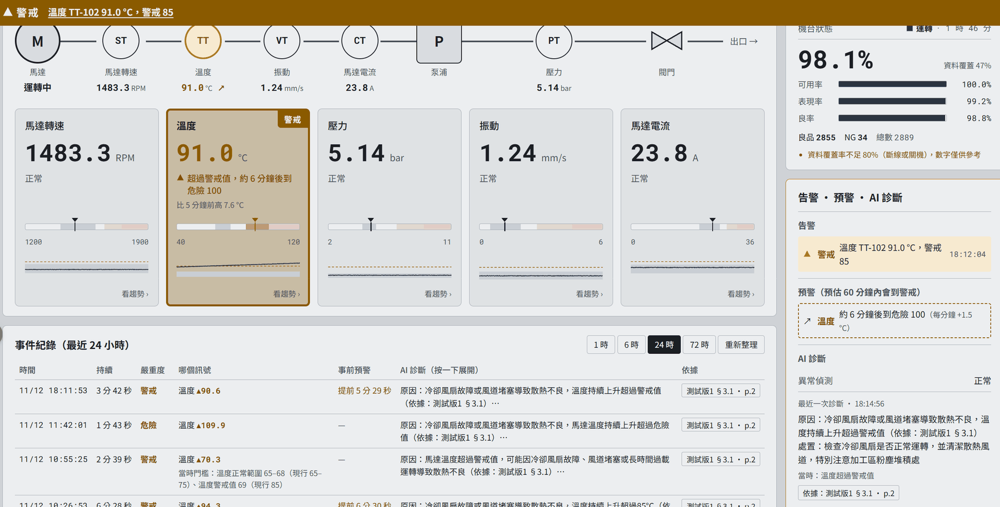
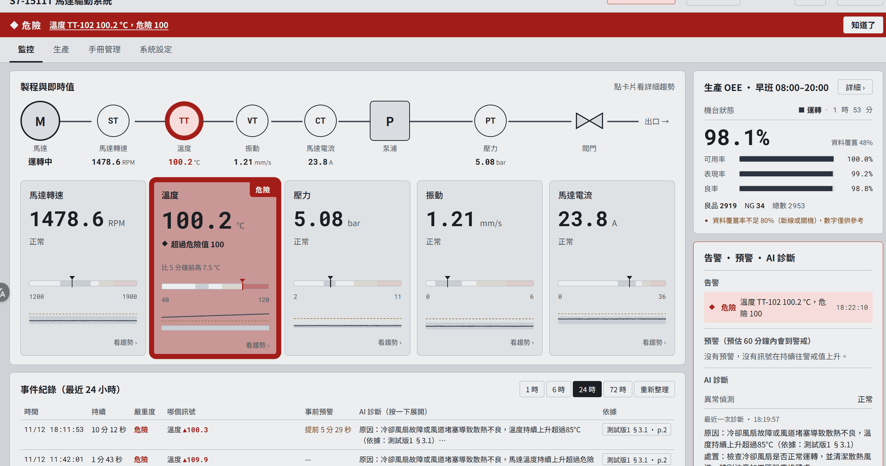
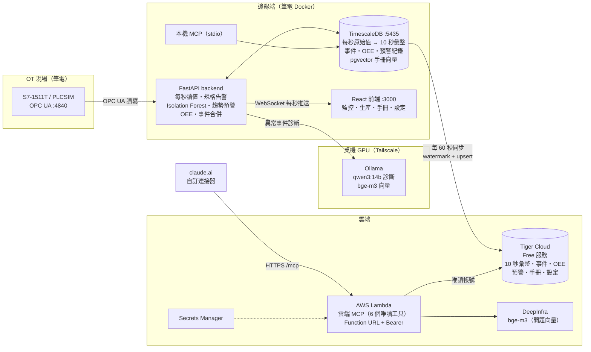

# IIoT SCADA Platform

> 從 PLC 到 AI 的端對端工業監控平台：Siemens S7-1511T × OPC UA × TimescaleDB × LLM 診斷 × 雲端 MCP

[](https://github.com/kapy0312/iot-scada-platform/actions/workflows/ci.yml)
[](LICENSE)


一台馬達驅動系統（轉速、溫度、壓力、振動、電流 5 個製程訊號＋機台狀態與產量），從 PLC 每秒讀值開始，一路做到：

- **看得到**：即時監控、規格告警、OEE
- **知道為什麼**：異常事件由本地 LLM 依設備手冊診斷，附章節與頁碼
- **事先知道**：趨勢預警在超標前 5～10 分鐘提醒，並用命中率與漏報率檢驗自己準不準
- **在任何地方問得到**：資料同步上雲，claude.ai 透過雲端 MCP 直接查設備狀況

## 畫面

**溫度劣化測試：系統在超標前就發出預警，事件紀錄顯示「提前 5 分 29 秒」**



**溫度過 100°C：危險告警橫幅、卡片標示，事件附 AI 診斷與手冊章節頁碼**



---

## 目錄

1. [定位：acatech Industrie 4.0 成熟度](#定位acatech-industrie-40-成熟度)
2. [系統架構](#系統架構)
3. [功能](#功能)
4. [趨勢預警成效](#趨勢預警成效)
5. [OEE 與班別規則](#oee-與班別規則)
6. [門檻設定](#門檻設定)
7. [雲端：Phase 1～3](#雲端phase-13)
8. [技術棧](#技術棧)
9. [專案結構](#專案結構)
10. [快速開始](#快速開始)
11. [PLC 與 PLCSIM 設定](#plc-與-plcsim-設定)
12. [API 端點](#api-端點)
13. [技術難點](#技術難點)
14. [已知限制與下一步](#已知限制與下一步)

---

## 定位：acatech Industrie 4.0 成熟度

德國 acatech 的 Industrie 4.0 Maturity Index 把數位化分成 6 個階段，每一階段回答一個問題。這個專案對照如下：

| 階段 | 回答的問題 | 本專案做到的事 |
|---|---|---|
| 1 電腦化 Computerisation | — | S7-1511T PLC 控制馬達、計數良品／NG |
| 2 連結 Connectivity | — | OPC UA 直連 PLC，不經第三方 Gateway；Tailscale 串接桌機 GPU |
| 3 可視化 Visibility | 發生了什麼？ | 即時監控頁、規格告警、TimescaleDB 歷史資料、OEE |
| **4 透明化 Transparency** | **為什麼發生？** | **Isolation Forest 偵測多訊號組合異常 → LLM 依手冊章節診斷原因與處置，記下當時門檻** |
| **5 可預測 Predictive capacity** | **接下來會發生什麼？** | **趨勢預警估「再過幾分鐘會到警戒／危險值」，命中率 100%、平均提前 7 分 40 秒（見下方實測）** |
| 6 自適應 Adaptability | 系統能自己應對嗎？ | 尚未實作（目前只寫入轉速設定、啟停，沒有自動降載） |

第 4、5 階段是這個專案的重點：不只顯示數字，還要說出原因，並且在問題發生前就提醒，再用數據證明提醒是準的。

---

## 系統架構



完整版架構圖（含副流程、參數速查、安全性檢視）：[docs/architecture.html](docs/architecture.html)（下載後用瀏覽器開啟），或看 [靜態圖](docs/images/architecture.png)。

**資料怎麼流**：PLC 每秒讀值 → 後端同時做告警、ML 判斷、趨勢預估、OEE 狀態記錄 → 寫進本機 TimescaleDB → TimescaleDB 自動彙整成 10 秒一筆 → 每 60 秒把彙整後的資料、事件、OEE、預警紀錄、手冊與設定同步到 Tiger Cloud → Lambda 上的 MCP server 只用唯讀帳號查雲端，給 claude.ai 使用。

**為什麼分兩層**：現場判斷（告警、預警、診斷）全部在邊緣端完成，斷網照常運作；雲端只是副本，用來在外面查詢與給 AI 分析。原始每秒資料不上雲，雲端用量維持在約 22 MB。

---

## 功能

### 監控與告警
- 製程流程圖＋5 張訊號卡片，每秒更新；卡片顯示正常範圍刻度條與最近趨勢
- 規格告警分兩級：**警戒**（黃，粗框底色）、**危險**（紅）
- 剛跨過門檻時卡片會閃爍：警戒閃 10 秒，危險一直閃到按「知道了」；解除後 30 秒內又回來算同一次
- 頁面最上方有告警橫幅（點文字跳到該卡片）、分頁標題顯示「⚠ 危險」、危險時可開嗶聲（預設關）

### 異常事件與 AI 診斷
- **Isolation Forest**：看 5 個訊號的組合是否「不像平常」，分數連續 5 秒低於門檻才算異常，抓得到單一訊號沒超標、但組合不對勁的狀況
- **事件合併**：正常超過 60 秒再異常才算新事件，同一次故障不會被拆成很多筆
- **恢復期**：停機、換模、剛開機、斷線重連後，先等數值穩定（30～120 秒）才判斷，避免把升溫過程當成異常
- **手冊診斷**：程式依異常訊號挑出手冊章節（pgvector 向量搜尋），再交給 Ollama qwen3:14b 寫原因與處置；章節由程式決定、不讓模型自己編，每筆診斷附「測試版1 §3.1・p.2」這類依據
- **記下當時門檻**：事件開始時記下 5 個訊號的門檻；之後就算門檻改了，回頭看舊事件仍用當時的標準判斷，並標註「當時門檻 69（現行 85）」

### 趨勢預警
- 用最近 10 分鐘的 10 秒平均值估上升速度，算出「再過幾分鐘會到警戒／危險值」，預估 60 分鐘內會到才發出預警
- 每筆預警都會追蹤結果：**真的到了**（命中）、**自己退了**、**中途停機**；並自動連到後來發生的事件
- 防誤報設計：資料要滿 5 分鐘、斜率要明顯大於雜訊、整段與最近 3 分鐘都要往上、漲幅要夠大夠穩、連續 30 秒成立才亮、連續 60 秒不成立才熄；上升趨緩時改用一階延遲模型估終點，到不了門檻就不預警

### 生產與 OEE
- 機台狀態（計畫停機、運轉、待機、故障、換模）、良品／NG 計數、品號
- 即時 OEE、班別報表、停機損失時間軸；品號標準週期與班別可在網頁設定

### 安全性
- 密碼只放 `.env`；容器不載入管理員帳密（只傳必要變數）
- 寫入 PLC、改門檻、上傳手冊等操作都要登入，並帶 `X-SCADA-Request` header 防跨站請求；每次操作記到 `audit_log`（誰、IP、修改前後的值）
- 雲端 MCP 沒設密碼時一律回 401；雲端資料庫分成同步用（edge_writer）與查詢用（mcp_reader，唯讀）兩個帳號

---

## 趨勢預警成效

評估預警好不好要同時看兩件事：

- **命中率**：發出的預警裡，有幾成真的到了（看有沒有**亂報**）
- **漏報率**：真的超標的事件裡，有幾成事前沒被預警到（看有沒有**漏掉**）

只看命中率會被騙：如果系統很保守、幾乎不發預警，命中率可以很高，但大部分故障都沒提醒到。

### 乾淨測試（2026-11-12 18:01～18:23，PLCSIM）

測試方式：`plcsim_ctl.py drift temp 1.5` 讓溫度從 70°C 每分鐘升 1.5°C，一路升過危險值 100°C 才停止，中途不介入。

| 預警 | 發出時溫度 | 預估多久到 | 實際提前量 | 預估誤差 |
|---|---|---|---|---|
| 警戒 85°C | 76.9°C | 5 分 19 秒 | **5 分 29 秒** | 晚到 10 秒 |
| 危險 100°C | 85.6°C | 9 分 39 秒 | **9 分 50 秒** | 晚到 11 秒 |

- 命中率 **100%**（2/2）、漏報率 **0%**（1 次超標事件，事前有預警）
- 平均提前 **7 分 40 秒**，預估時間與實際只差約 10 秒
- 估出來的上升速度在每分鐘 1.46～1.52°C 之間，實際設定是 1.5°C

### 累積數據（2026-11-05～11-12，含開發期間的測試）

| 指標 | 數值 | 說明 |
|---|---|---|
| 命中率 | 57%（4/7） | 3 筆「自己退了」都是開發測試時中途關掉 drift 造成的，不是系統誤判 |
| 漏報率 | 40%（2/5） | 從預警功能上線（2026-11-11 17:50）開始算；之前的 6 次超標事件不計 |

2 次漏報都有明確原因，也各自對應到下一步的改善：

| 事件 | 原因 | 對策 |
|---|---|---|
| 39 | 測試時把溫度警戒值暫時改成 69，數值沒變卻變成超標 | 告警處理會把「門檻變更造成的超標」標示出來，另附扣除後的漏報率 |
| 40 | 溫度一兩分鐘內衝到 109.9°C，趨勢預警來不及（它需要 5 分鐘資料） | 加入變化率告警（ISA-18.2 rate-of-change），升太快直接警報 |

> 數據來源：雲端 MCP `list_trend_warnings`。命中率、漏報率在 `/api/trend/warnings` 與 MCP 都會即時計算。

---

## OEE 與班別規則

```
可用率 = 運轉時間 ÷（有資料時間 − 計畫停機時間）   該開工的時間裡，真的在動的比例
表現率 = Σ(件數 × 標準週期) ÷ 運轉時間，最多 100%  動的時候跑得夠不夠快
良率   = 良品 ÷ 總數                               做出來的有幾成是好的
OEE    = 可用率 × 表現率 × 良率
```

- **資料覆蓋率**：有資料的時間 ÷ 這段時間總長。斷線、關機的時段不算進分母，覆蓋率低於 80% 時畫面會提示「數字僅供參考」，避免斷線讓 OEE 看起來特別好
- **表現率超過 105%** 時提示「標準週期可能設錯」
- **班別**：整點切換、台北時間；可以跨午夜（例如 20～8），班別歸屬「開始那一天」（11/11 晚班＝11/11 20:00～11/12 08:00）；目前不分星期
- 資料來源是 TimescaleDB 每小時彙整的 `oee_hourly`（各狀態秒數、良品、NG），保留 2 年

---

## 門檻設定

在「系統設定」頁可以改每個訊號的正常範圍、警戒值、危險值與刻度：

- 改完立刻生效：告警、趨勢預警、恢復期判斷、AI 診斷、前端卡片都用同一份門檻
- 其他開著的網頁會自動跟上（門檻有版本指紋，變了就重新載入）
- 每次修改記到 `audit_log`（修改前、修改後、誰改的）；可一鍵恢復預設值
- 事件記下當時門檻，事件進行中門檻被改過會標記 `limits_changed`
- 設定同步上雲，雲端 MCP 回答時用的門檻跟網頁一致

---

## 雲端：Phase 1～3

### Phase 1：雲端同步（Tiger Cloud）

本機每秒原始資料由 TimescaleDB 自動彙整成每 10 秒一筆（平均、最小、最大、筆數），backend 每 60 秒同步到 Tiger Cloud（Free 服務）。

| 同步目標 | 內容 |
|---|---|
| `measurements_10s` | 10 秒彙整（雲端保留 30 天、7 天後壓縮） |
| `anomaly_incidents` | 事件、AI 診斷、當時門檻 |
| `oee_hourly` | 每小時 OEE 原始數據 |
| `trend_warnings` | 趨勢預警與結果 |
| `manual_documents` | 手冊與段落向量（本機刪除 → 雲端標記刪除） |
| `settings` | 門檻、品號標準週期、班別 |

- **不漏**：同步指標（watermark）只在雲端確認收到後才往前推；斷線、雲端暫停、backend 重開都從原處補送
- **不重複**：以主鍵 upsert，重送只會覆蓋
- **晚到資料**：每輪往回多送 15 分鐘
- **同時只有一個同步程序**：用 PostgreSQL advisory lock
- **不同步**：`-MOCK` 設備（後端內建亂數模擬）

### Phase 2：手冊向量搬到 pgvector

手冊段落向量從 Qdrant 搬進 TimescaleDB 內建的 pgvector（HNSW、cosine），少維護一個資料庫，而且能跟著同步上雲。

- 搬移 3 份手冊 38 段；Qdrant 與 pgvector 對 56 題測試問題的檢索結果完全一致
- `RAG_BACKEND` 決定查哪一邊，過渡期寫入兩邊都寫；目前已切到 pgvector，下一步移除 Qdrant

### Phase 3：雲端 MCP

讓 claude.ai 在任何地方都能查設備狀況，不需要開著筆電。

- **6 個唯讀工具**：`list_anomalies`（事件與診斷）、`get_trend`（趨勢）、`search_manual`（查手冊）、`get_device_info`（規格與門檻）、`get_oee`、`list_trend_warnings`（預警成效）；時間範圍最多 7 天
- **同一份工具程式碼**（`mcp_tools/`），本機版接 TimescaleDB、雲端版接 Tiger Cloud
- **部署**：AWS SAM → Lambda（容器映像、Lambda Web Adapter、Streamable HTTP 無狀態模式）＋ Function URL；設定值放 Secrets Manager；log 保留 14 天
- **問題向量**：雲端改用 DeepInfra 的 bge-m3（與本機 Ollama 同一個模型）。實測兩邊的手冊段落向量相似度最低 0.9999、56 題依據章節全部一致，所以手冊向量不用重算

```powershell
cd backend
python mcp_cloud/smoke_test.py <Function URL>/mcp     # 雲端冒煙測試
python tools/test_mcp_tools.py S7-1511T-SIM 24         # 本機 6 個工具
```

---

## 技術棧

| 層級 | 技術 | 說明 |
|---|---|---|
| PLC | Siemens S7-1511T、TIA Portal V20、PLCSIM | SCL 模擬機台（含漸進劣化、故障、換模） |
| 通訊 | OPC UA（`asyncua`） | 直連 PLC，讀寫各用獨立 Session |
| 後端 | FastAPI + asyncio | 讀值、告警、ML、預警、寫入並行不阻塞 |
| 時序資料庫 | TimescaleDB + pgvector | hypertable、continuous aggregate、保留與壓縮政策、向量搜尋 |
| 異常偵測 | scikit-learn Isolation Forest | 無監督，只用正常資料訓練 |
| 趨勢預估 | NumPy（Theil–Sen 斜率、MAD 雜訊、Kendall τ） | 對突波不敏感的穩健估計 |
| LLM | Ollama qwen3:14b、bge-m3 | 桌機 RTX 5060 Ti，經 Tailscale 存取，資料不外傳 |
| 前端 | React + TypeScript + Vite | WebSocket 即時更新 |
| 雲端 | Tiger Cloud、AWS Lambda、SAM、Secrets Manager、DeepInfra | 雲端 MCP 每月成本接近 0 |
| AI 介面 | Model Context Protocol（MCP） | 本機 stdio＋雲端 Streamable HTTP |
| 部署 | Docker Compose | backend、frontend 兩個容器 |

---

## 專案結構

```
iot-scada-platform/
├── backend/
│   ├── main.py                  # FastAPI 進入點
│   ├── core/
│   │   ├── plc_simulator.py     # 主迴圈：OPC UA 讀值 → 告警、ML、預警、OEE、寫入
│   │   ├── device_profile.py    # 設備規格（訊號、正常範圍、警戒、危險）
│   │   ├── limits.py            # 門檻覆寫（網頁改的門檻）
│   │   ├── incidents.py         # 事件合併、嚴重度、當時門檻
│   │   ├── production.py        # 機台狀態、恢復期（RunGate）
│   │   ├── trend.py             # 趨勢預估（純計算）
│   │   ├── warning_stats.py     # 命中率、漏報率
│   │   ├── oee.py               # OEE 計算、班別規則（純計算）
│   │   └── auth.py              # 登入、session、操作紀錄
│   ├── routers/                 # API：realtime、control、history、trend、oee、device、rag、system、auth
│   ├── ml/                      # Isolation Forest 訓練、推論、自動再訓練、Ollama 診斷
│   ├── rag/                     # 手冊切段、向量、pgvector／Qdrant
│   ├── db/
│   │   ├── migrations/          # 本機 001～010（每個都有 rollback）
│   │   └── cloud/               # 雲端 001～006（每個都有 rollback）
│   ├── sync/cloud_sync.py       # 雲端同步
│   ├── mcp_tools/               # MCP 工具（本機、雲端共用）
│   ├── mcp_server.py            # 本機 MCP（stdio）
│   ├── mcp_cloud/               # 雲端 MCP：server、SAM template、冒煙測試
│   ├── tools/                   # 管理工具：plcsim_ctl、sync_admin、cloud_admin、rag_migrate…
│   └── tests/                   # pytest
├── frontend/src/
│   ├── components/              # ProcessOverview、AlarmBanner、AlarmPanel、EventLog、TrendLog、OeeCard…
│   └── hooks/                   # useWebSocket、useAlarms、useAlarmAttention…
├── plc/                         # FB_MachineSim.scl、FB_Production.scl、DB1 變數
├── docker-compose.yml           # 使用現有 TimescaleDB 容器
└── docker-compose.full.yml      # 全新部署（含 TimescaleDB）
```

---

## 快速開始

### 環境需求

- Docker Desktop
- Python 3.11（conda，開發與管理工具用）
- Node.js 20+（前端開發用）
- TimescaleDB 容器（內建 pgvector）
- Ollama + qwen3:14b、bge-m3（本機或經 Tailscale）
- Siemens TIA Portal V20 + PLCSIM（或實機 S7-1511T）

### 1. 設定 .env

程式碼與 docker-compose 都不寫密碼，一律從 repo 根目錄的 `.env` 讀取（已被 `.gitignore` 排除）。

```powershell
Copy-Item .env.example .env
python -c "import secrets; print(secrets.token_urlsafe(24))"   # 產生隨機密碼，填進 POSTGRES_PASSWORD
```

主要變數：`POSTGRES_PASSWORD`、`RAG_BACKEND`（pgvector）、`CLOUD_SYNC_ENABLED`、`TIGER_EDGE_URL`。選填的趨勢預警、班別時區、恢復期等參數都列在 `docker-compose.yml` 的 `environment`。

### 2. 建立資料表

`backend/db/migrations/` 的 001～010 依編號執行，每個檔案開頭都寫了執行指令、用途與確認用的 SQL，也都有對應的 rollback。例如：

```powershell
Get-Content backend/db/migrations/010_incident_limits.sql | docker exec -i timescaledb psql -U postgres -d iotscada
```

雲端資料表在 `backend/db/cloud/`，用 `python -m tools.cloud_admin apply db/cloud/001_schema.sql` 依序套用。

### 3. 建立帳號

```powershell
cd backend
python -m tools.create_user kevin            # 密碼互動輸入，不會留在指令紀錄
python -m tools.create_user --list
```

### 4. 啟動

```powershell
docker start timescaledb
docker compose up -d --build
```

- 前端：`http://localhost:3000`
- API 文件：`http://localhost:8000/docs`
- backend 剛啟動 10 幾秒內呼叫 API 可能回 ResponseEnded，等一下再試

用 Tailscale IP 開前端時，要把那個網址加進 `.env` 的 `CORS_ORIGINS`，登入 cookie 才會被帶上。

### 5. 驗證

```powershell
cd backend
python -m pytest tests -q            # 沒有測試資料庫時，需要資料庫的測試會自動略過
python -m tools.sync_admin status    # 雲端同步狀態
python -m tools.cloud_admin check    # 雲端兩個帳號的權限
```

---

## PLC 與 PLCSIM 設定

### OPC UA Server

1. CPU 屬性 → OPC UA → Server → 啟動 OPC UA Server，Port 4840
2. DB1 屬性取消「優化塊存取」，變數勾選「可從 HMI/OPC UA 存取」
3. 不建立 Server Interface（TIA Portal V17 編譯時曾因 RAM 不足當機，改用 Standard Interface）

### 模擬機台

`plc/FB_MachineSim.scl` 模擬 5 個製程訊號（一階延遲＋雜訊），`plc/FB_Production.scl` 模擬機台狀態與計數，DB1 需要的變數列在 `plc/DB1_新增變數.txt`。

`tools/plcsim_ctl.py` 用 OPC UA 控制 PLCSIM，方便重現各種情境：

```powershell
cd backend
python tools/plcsim_ctl.py status
python tools/plcsim_ctl.py fault 2                  # 注入故障（0 解除）
python tools/plcsim_ctl.py drift temp 1.5           # 溫度每分鐘 +1.5°C（驗證趨勢預警）
python tools/plcsim_ctl.py planned on               # 計畫停機
python tools/plcsim_ctl.py changeover on            # 換模
python tools/plcsim_ctl.py product 2                # 切品號
```

device_id 規則：`S7-1511T`＝實機、`S7-1511T-SIM`＝PLCSIM、`S7-1511T-MOCK`＝後端內建模擬（不同步上雲，不進訓練資料）。

---

## API 端點

| 方法 | 路徑 | 說明 |
|---|---|---|
| `WS` | `/ws/realtime` | 每秒推送讀值、告警、ML 分數、趨勢預估、機台狀態 |
| `GET` | `/api/history` | 歷史資料 |
| `GET` | `/api/incidents` | 事件紀錄（含 AI 診斷、當時門檻、事前預警） |
| `GET` | `/api/trend/current` | 各訊號目前的預警狀態 |
| `GET` | `/api/trend/warnings` | 預警紀錄、命中率、漏報率 |
| `GET` | `/api/oee/current`、`/shifts`、`/timeline` | OEE 即時值、班別報表、停機時間軸 |
| `GET` / `PUT` | `/api/oee/config`、`/products`、`/shifts` | 品號標準週期、班別設定 🔒 |
| `GET` | `/api/device-profile/{device_id}` | 設備規格與目前門檻 |
| `PUT` / `DELETE` | `/api/device-profile/{device_id}/limits/{tag}` | 修改門檻／恢復預設 🔒 |
| `POST` | `/api/control/write` | 寫入 motor_enable、motor_speed_setpoint 🔒 |
| `POST` / `GET` / `DELETE` | `/api/rag/upload`、`/documents` | 手冊上傳、列表、刪除 🔒 |
| `GET` | `/api/system/sync-status` | 雲端同步狀態 |
| `POST` | `/api/auth/login`、`/logout` | 登入、登出 |

🔒 需要登入 cookie 與 `X-SCADA-Request: 1` header。

---

## 技術難點

### 1. 預警要準，也要證明自己準
趨勢預估最容易出的問題是「一直亂報」：雜訊、環境溫度慢慢飄、熱機升溫都會被當成上升趨勢。這裡用穩健統計（Theil–Sen 斜率、MAD 雜訊、Kendall τ 方向一致性）加上延遲生效來擋誤報，再把每筆預警的結果寫進資料庫，用命中率與漏報率回頭檢驗。過程中也修正過指標本身的錯誤：預警危險值時數值掉回警戒值以下，以前被誤判為命中；漏報率一開始把功能上線前的事件也算進去。

### 2. 門檻會變，歷史判斷不能跟著變
門檻可以在網頁上改，但舊事件如果用新門檻重新判斷，就會出現「全部正常卻有診斷」的矛盾。解法是事件開始時把門檻快照存進事件，判斷與 AI 回答都用當時的門檻，並標註與現行門檻的差異。

### 3. 不讓 LLM 編造依據
早期讓模型自己引用手冊章節，結果會挑錯或編出不存在的章節。改成由程式依異常訊號選章節，模型只負責寫原因與處置，每筆診斷都能追溯到手冊頁碼。

### 4. 邊緣與雲端的資料一致性
同步要做到斷線不漏、重送不重複、晚到資料能補、多個程序不衝突：watermark 只在雲端確認後前進、主鍵 upsert、每輪往回重疊 15 分鐘、advisory lock。雲端帳號分成可寫與唯讀，手冊與設定表只開放必要的刪除權限。

### 5. 換向量服務不用重算
雲端 Lambda 連不到桌機 Ollama，問題向量改用 DeepInfra。先實測兩邊同一個模型（bge-m3）算出的向量幾乎相同（相似度 ≥ 0.9999、56 題依據章節一致），才決定沿用本機算好的手冊向量。

### 6. OT 狀態影響 IT 判斷
停機、換模、剛開機時數值本來就會變動。用 RunGate 控制什麼時候該判斷：這些時段 ML 不判斷、趨勢預警清空視窗並把進行中的預警記為「中途停機」，不算進命中率。

---

## 已知限制與下一步

**已知限制**
- 趨勢預警需要 5 分鐘資料，一兩分鐘內急升的狀況來不及預警（由變化率告警補）
- 驗證資料來自 PLCSIM 模擬，尚未在實機長期運轉
- 班別不分星期

**下一步**
1. 移除 Qdrant，手冊向量完全使用 pgvector
2. 告警處理：確認、擱置、處理紀錄寫進資料庫、主動通知、誤報回饋
3. 變化率告警（ISA-18.2 rate-of-change），補趨勢預警抓不到的急升
4. 門檻變更造成的超標加上標示，漏報率另附扣除版本
5. 網頁顯示雲端同步狀態與漏報率

---

## 履歷技能關鍵字

`IIoT` `SCADA` `OPC UA` `Siemens S7-1500` `TIA Portal` `PLCSIM` `SCL` `FastAPI` `asyncio` `WebSocket` `React` `TypeScript` `TimescaleDB` `PostgreSQL` `pgvector` `RAG` `Isolation Forest` `Predictive Maintenance` `OEE` `ISA-18.2` `Ollama` `LLM` `MCP` `AWS Lambda` `AWS SAM` `Secrets Manager` `Tiger Cloud` `Docker` `Tailscale` `acatech Industrie 4.0 Maturity Index`

---

## License

[MIT](LICENSE)
